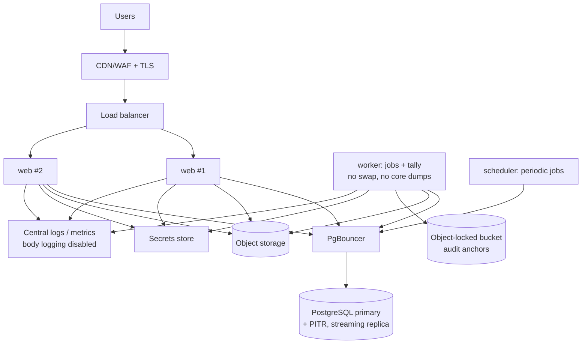

# Phase 2 — Architecture

> **Status:** Draft for the Phase 2 gate. This builds on [BLUEPRINT.md](BLUEPRINT.md) §3 and the decisions in [DECISIONS.md](DECISIONS.md).

## 1. Technology baseline

| Concern | Choice | Notes |
|---|---|---|
| Language / framework | Python 3.12+, **Django 5.2 LTS** | Long-term-support releases run until April 2028. Upgrade to the next LTS before then. |
| Database | **PostgreSQL 16+**, accessed through psycopg 3 | Row-Level Security, triggers, separate database roles. |
| UI | Django templates + **HTMX 2**, a small amount of plain JavaScript, no SPA framework | Works with JavaScript off, except for the idempotent ballot submit, which still works as a plain form post. |
| CSS | Hand-written, mobile-first CSS (no build step), or Tailwind standalone CLI if a build step is acceptable | Pages kept under 100 KB on 3G networks. |
| Password hashing | `argon2-cffi` (Django's `Argon2PasswordHasher`) | Parameters in [05 §2](05-security-review.md#2-authentication-and-session-design). |
| Second factor | `django-otp` (TOTP + static recovery codes), `py_webauthn` (passkeys for officials) | — |
| Ballot cryptography | **PyNaCl** (libsodium): `crypto_box_seal`, `crypto_secretbox`, `crypto_pwhash` (Argon2id) | — |
| Background jobs | **Procrastinate**, a task queue that stores jobs in PostgreSQL | No Redis or broker to run. Also provides periodic jobs. |
| Object storage | S3-compatible with **object lock** (cloud S3, or MinIO on a Kenyan host) | Nomination documents (server-side encrypted) and anchors for the audit chain. |
| Email | Transactional provider over SMTP or API (a provider choice per hosting region) | Messages carry no personal data beyond what is needed, and never any ballot content. |
| Packaging | Docker image (one image, three process types) | Portable across hosting providers (D4). |
| Continuous integration | GitHub Actions | Lint (ruff), type check (mypy), tests (pytest + pytest-django against real PostgreSQL), dependency audit (pip-audit), static analysis (bandit, semgrep), container scan. |
| Error tracking | Sentry or GlitchTip (self-hosted) with personal-data scrubbing turned on | Request bodies are **not** captured. |

## 2. Module decomposition (Django apps)

```
platform_core/     settings, middleware, DB router, request context, security headers
accounts/          User, auth, TOTP/WebAuthn, invitations, password reset, sessions
tenancy/           Organisation, OrgMembership, RoleAssignment, org context + RLS middleware, permissions
members/           Member register, CSV import, deactivation
meetings/          Meeting
elections/         Election, ElectionRuleVersion, LifecycleTransition, state machine service, scheduler jobs
nominations/       Nomination, NominationDocument, Candidate, review workflow
electorate/        ElectorateSnapshotEntry, Entitlement issuance, freeze
voting/            Ballot casting service + view (uses the `voting` database alias only)
keys/              Key ceremony, KeyShareHolder, share-bundle format, key reconstruction (tally worker only)
tally/             Tally, TallyLine, TieResolution, reconciliation, recount, Certification, publication
quorum/            ParticipationRecord, quorum rule evaluation
audit/             AuditEvent writer, chaining job, anchoring job, verification command + auditor views
platform_admin/    Platform Owner console (org provisioning, health); no access to ballot tables
```

**Dependency rule:** modules call each other only through each module's `services.py`. Views never import another module's models directly. An import-linter contract enforces this in continuous integration.

## 3. Database roles and connection aliases

| Django alias | PostgreSQL role | Can do | Cannot do |
|---|---|---|---|
| `default` | `app_rw` | Read and write all tenant tables **except** those listed in the last column; insert into `audit_event` | Any access to `ballot`; UPDATE/DELETE on `audit_event`, `tally*`, `certification`; changes to `entitlement` after the election opens (enforced by trigger) |
| `voting` | `app_voting` | SELECT on `election`, `candidate`, `election_rule_version`, `entitlement`; UPDATE on `entitlement(status, consumed_on, idempotency_hash)`; INSERT on `ballot`, `audit_event` | Any other table; reading `ballot` |
| `tally` | `app_tally` | SELECT on `ballot`, `candidate`, `entitlement` (counts only, through a view), `election`, `election_rule_version`; INSERT on `tally`, `tally_line`, `audit_event` | Any change to `ballot`, `entitlement` or `election` |
| `platform` | `app_platform` | Manage `organisation`, `user` metadata; read-only health views | All tenant election tables |
| (migrations only) | `app_owner` | Owns the schema; used only by the migration job | Never used by running processes |

- None of these roles has `BYPASSRLS` or `SUPERUSER`.
- A Django database router sends each module's models to its alias. A test asserts that `voting/` code paths never open the `default` connection during a ballot submission.

## 4. Request lifecycle and tenancy enforcement

1. `SecurityHeadersMiddleware` sets the HTTP security headers: a strict Content-Security-Policy (no inline scripts), HSTS, `frame-ancestors 'none'`, Referrer-Policy and Permissions-Policy.
2. Authentication loads the user from the server-side session.
3. `OrgContextMiddleware`:
   - resolves `org_slug` from the URL;
   - loads the user's `OrgMembership`, or returns **404** (never 403, so it can't be used to discover which organisations exist);
   - attaches `request.org` and `request.roles`.
4. Every request runs inside a transaction (`ATOMIC_REQUESTS`). The middleware runs `SET LOCAL app.org_id = '<uuid>'` on each connection alias the request uses. Because this is `SET LOCAL`, the setting is scoped to the transaction and is safe with PgBouncer in transaction-pooling mode.
5. Views are protected by `@requires(permission)` decorators. Permissions map to roles in one table in code ([§6](#6-permission-matrix)), and that table is unit-tested.
6. A base manager adds an `organisation_id` filter as a second, redundant layer. If a query runs without an organisation context it raises an exception, and the RLS policy returns zero rows anyway.

## 5. Key data flows

### 5.1 Casting a ballot

```mermaid
sequenceDiagram
  participant B as Browser
  participant V as Voting view (alias: voting)
  participant DB as PostgreSQL
  B->>V: GET ballot page
  V->>DB: entitlement status, candidates, rules
  V-->>B: form + idempotency_key (signed, bound to entitlement id + expiry)
  Note over B: browser generates receipt_secret,<br/>stores it in localStorage
  B->>V: POST selections, idempotency_key, SHA-256(receipt_secret)
  V->>DB: BEGIN; lock election FOR SHARE; lock entitlement FOR UPDATE
  V->>V: validate; pad; crypto_box_seal(pk)
  V->>DB: INSERT ballot; UPDATE entitlement; INSERT audit_event; COMMIT
  V-->>B: 200 accepted (only after COMMIT)
  Note over B: shows receipt code from receipt_secret.<br/>On timeout: retry with the same key
```

- **Without JavaScript**, the browser can't generate `receipt_secret`. The server then generates it, returns it once in the response and doesn't keep it. The trade-off: the server sees the secret transiently, so the receipt is weaker for this voter.
- The idempotency key is signed with HMAC and bound to the entitlement ID, so it can't be replayed against another voter's entitlement.

### 5.2 Counting

```mermaid
sequenceDiagram
  participant RO as Returning Officer
  participant K as Keyholders (k of n)
  participant W as Tally worker (alias: tally)
  participant DB as PostgreSQL
  RO->>W: start tally (step-up auth)
  K->>W: upload share bundle + passphrase (each, in own session)
  W->>W: reconstruct sk in memory (mlock'd buffer)
  W->>DB: SELECT ciphertexts (election)
  W->>W: Merkle root → compare with digest stored at close
  W->>W: shuffle, decrypt, validate, aggregate; wipe sk
  W->>DB: INSERT tally + lines + reconciliation + audit_event
```

- Share bundles are kept only in a short-lived, encrypted job record that is deleted when the tally finishes or after a 30-minute timeout.
- The private key is never written to disk or logs. The worker containers run with swap disabled and core dumps turned off.

### 5.3 Scheduled transitions
- A periodic job runs every minute. It moves `Scheduled → Open` at `opens_at` (freezing the snapshot and issuing entitlements) and `Open → Closed` at `closes_at` (and computes the ballot-set digest).
- **The ballot endpoint checks the voting window against database time on its own** and doesn't rely on the job. If the job runs late, ballots are still refused after `closes_at`, and before opening voting simply waits. An alert fires if a transition is more than 2 minutes late.

## 6. Permission matrix

The full matrix lives in code (`tenancy/permissions.py`). Summary (✓ = allowed, — = not allowed):

| Permission | Platform Owner | Org Admin | Returning Officer | Auditor | Candidate | Member |
|---|---|---|---|---|---|---|
| Provision an organisation and its first admin | ✓ | — | — | — | — | — |
| Manage members and invitations | — | ✓ | read | — | — | — |
| Grant roles | — | ✓ (not to self) | — | — | — | — |
| Create or edit an election (Draft only) | — | ✓ | ✓ | — | — | — |
| Approve rules / schedule (key ceremony) | — | — | ✓ | witness | — | — |
| Open nominations / review | — | ✓ | ✓ | — | — | — |
| Decide on nominations | — | — | ✓ | — | — | — |
| Submit a nomination / view own | — | — | — | — | ✓ | ✓ (if eligible) |
| Suspend / resume / cancel | — | co-sign cancel | ✓ | — | — | — |
| Cast a ballot | — | — | — | — | if in electorate | if in electorate |
| View voted / not-voted per member | — | — | ✓ | ✓ | — | own |
| Run tally / order recount | — | — | ✓ | — | — | — |
| Provide a key share | — | if appointed | if appointed | if appointed | — | — |
| Certify | — | — | ✓ | optional 2nd approver | — | — |
| Publish certified results | — | ✓ | ✓ | — | — | — |
| View audit trail / verify chain | — | filtered | ✓ | ✓ | — | — |

**Separation of duties** (on by default, configurable per organisation):
- The person who certifies can't be the person who created the election's rule version.
- The Platform Owner holds no organisation roles unless explicitly granted one by that organisation. Any such grant is audited.

## 7. Deployment topology



- **Environments:** `dev` (local Docker Compose), `staging` (fictional data only), `production` (in a Kenyan data centre, per D4).
- **Infrastructure as code:** Terraform or OpenTofu where the provider supports it. Otherwise a documented Ansible playbook.
- **Access:** production shell and database access goes through a bastion with short-lived credentials. Every session is logged. There are no standing database superuser credentials for people. Break-glass credentials are sealed and their use is audited.

## 8. Observability without leaking ballots
- The log format is structured JSON with an **allow-list** of fields. Ballot routes log only: route, status, latency, org_id, election_id, and a request ID.
- Metrics: request rates, errors, latency, transaction retries, ballot accept/reject counts per election. There are **no** counts per candidate before certification.
- An automated "canary candidate" test casts ballots for a candidate with a unique marker name, then searches the logs, error tracker payloads, emails and audit records for that marker. The test fails if it finds one.

## 9. Testing strategy (overview)
- Unit tests for the domain services (state machine, rule validation, tally, reconciliation, quorum).
- Integration tests against real PostgreSQL with RLS and the real database roles, never SQLite.
- Concurrency tests that fire many submissions in parallel threads or processes, each on its own connection.
- Property-based tests (Hypothesis): the tally is compared with an independent reference counter over randomised elections.
- End-to-end browser tests with Playwright on mobile viewports (Chromium and WebKit) for acceptance test 17. Testing on real devices is done manually in Phase 7.
