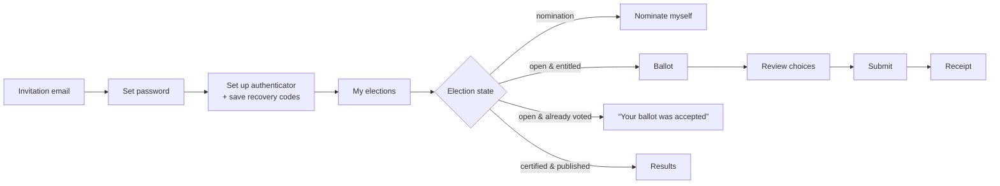

# Phase 4 — UX and Workflows

> **Status:** Draft for the Phase 4 gate. This document describes the screens in words. Clickable wireframes come after this structure is approved.

## 1. Design principles
- **Mobile first.** Target a 360 px wide screen, touch targets of at least 44 px, and pages that work on low-end Android phones over 3G.
- **Plain language** (English first, text ready for translation). No legal jargon in the voter flow.
- **Each screen does one thing**, especially in the voting flow. Destructive or irreversible actions always have a confirmation step that says exactly what will happen.
- **Accessibility:** WCAG 2.2 AA. Use semantic HTML, give every input a visible label, and never use colour as the only signal. Ballot choices are real checkboxes inside a `<fieldset>` with a `<legend>`.
- **Privileged actions** ask the user to confirm their second factor again if they last did so more than 5 minutes ago (step-up). The prompt names the action: "Confirm with your authenticator to **close nominations**".

## 2. Member workflow

### Screens

| Screen | Content | Error and edge states |
|---|---|---|
| **Accept invitation** | Organisation name, the member's name (partly masked), a password field with a strength hint | Link expired → "Ask your administrator to resend your invitation". Link already used → go to sign-in. |
| **Authenticator setup** | QR code with a manual key, enter a code to confirm, then 10 recovery codes with "I have saved these" | Wrong code → retry, with no limit on attempts during setup. A "Help: I don't have an authenticator app" link to an explainer. |
| **Sign in** | Email + password → TOTP code (or recovery code) | Always the same message: "Email or password is incorrect" (so attackers can't tell which emails have accounts). After repeated failures: "Too many attempts. Try again in N minutes." |
| **My elections** | One card per election: title, state in plain words ("Voting open until Thu 14 Nov, 17:00"), and an action button | No elections → "You have no elections at the moment." Not in the electorate → "You are not on the voter list for this election. Contact the Returning Officer if you believe this is wrong." |
| **Ballot** | Seat count ("Choose **up to 5** candidates"), candidate list (name, optional statement link), a live counter ("2 of 5 selected"), a **Review** button | Selecting more than allowed → the extra checkbox is disabled and the counter turns into a warning (the server rejects it too). No selection when blank ballots aren't allowed → "Select at least N". |
| **Review** | Chosen names listed. "You have chosen 3 of 5. You can leave seats unfilled." Warning: "**You cannot change your vote after submitting.**" Buttons: **Submit ballot** / **Go back** | — |
| **Submitting** | Button turns into a spinner. Clicking twice does nothing. | Network error or timeout → "We could not confirm your ballot yet. **Do not close this page.** Retrying…". The page retries automatically with the same submission key (3 tries with backoff), then shows **Check status**. It never claims success without confirmation from the server. |
| **Receipt** | "✅ Your ballot was accepted." Receipt code (e.g. `K7QM-4XPA-93TR`). Explainer: "This code does not show how you voted. After voting closes you can check that it appears in the list of counted ballots." Buttons: Copy / Save as text | — |
| **Already voted** | "A ballot has already been accepted for you in this election." | If this is the same browser that just submitted, the receipt code is shown again from local storage. Otherwise: "If you did not vote, contact the Returning Officer immediately." |
| **Election closed / not yet open** | Plain message with the times shown in Nairobi time | Submitting after closing time → "Voting closed at 17:00. Your ballot was **not** recorded." |
| **Election suspended** | "Voting is temporarily paused by the Returning Officer." Shows the reason if the RO chose to publish it. | — |
| **Results** | Certified results: seats, elected candidates, votes per candidate, turnout, quorum outcome, certification statement and time. A link to check receipts. | Not yet published → "Results will appear here once certified." |
| **Receipt check** | Enter a code → "Found in the counted ballots" or "Not found" (with a contact link) | — |

## 3. Candidate workflow

| Step | Screen | Rules / errors |
|---|---|---|
| 1 | **Nominate** (shown only while nominations are open and the member is eligible): statement (up to 4,000 characters), optional proposer/seconder chosen by member number, optional PDF | Not eligible → explanation of which rule wasn't met (category, subscription, cutoff). File rejected → type or size message. |
| 2 | **Proposer/seconder confirmation**: the named members get an email and a "Confirm nomination of X" screen | Not confirmed by the deadline → the nomination shows "Awaiting seconder". The RO decides whether it can stand. |
| 3 | **My nomination status**: Submitted → Approved / Rejected (with reason) | Can withdraw until review starts. Candidates never see other candidates' unpublished nominations. |

## 4. Org Admin workflow
1. **Organisation settings:** name, timezone, default governance settings, retention periods, separation-of-duties switches.
2. **Members:**
   - list with search, filter and status;
   - add or edit a member;
   - **CSV import** with a dry-run preview showing rows that will be created, updated or rejected, with reasons;
   - deactivate a member;
   - resend an invitation.

   Editing members is allowed at any time, **but** it has no effect on an election that is already open (the snapshot is frozen). A banner says so.
3. **Roles:** assign the Returning Officer, Auditor and other admins. An admin can't grant roles to themselves.
4. **Meetings & elections:**
   - create a meeting;
   - create an election (title, seats, times);
   - edit the draft rules using a form that maps to the rule JSON, with plain-language previews such as "Members may choose up to 5 candidates. Partial ballots are allowed.";
   - submit it for RO approval.
5. **Turnout dashboard** (once open): aggregate numbers only — "312 of 1,040 eligible members have voted (30%)".

## 5. Returning Officer workflow

| Stage | Screen | Key actions |
|---|---|---|
| Nomination / Review | Nomination queue | Approve, or reject with a mandatory reason. Set ballot order. Close nominations. |
| Ready for approval | **Approval summary**: rule version diff, candidate list, seat count, times, electorate *preview* (count + downloadable list), tie procedure text, quorum rule | **Approve & schedule** starts the key ceremony. **Return to draft** requires a reason. |
| Key ceremony | Wizard for each keyholder: confirm identity (step-up), set a passphrase twice, download the encrypted share bundle, confirm the download by entering the last 6 characters of the bundle fingerprint. A backup share is printed as a QR code plus text for a sealed envelope. Then a **test decryption** using *k* shares. | The ceremony can't finish until the test decryption succeeds. The public-key fingerprint is shown for the record. |
| Open | Live panel: state, time remaining, turnout, rejected-submission counts by reason (outside window, over-selection, not eligible) | **Suspend** (with reason), cancel (needs the admin to co-sign), marked register (voted / not voted) |
| Suspended | Reason, history, option to add or revoke electorate entries (each with a reason), set a new closing time | **Resume** (with reason) |
| Closed | Ballot-set digest, entitlements consumed vs ballots stored | **Start tally** → keyholders are prompted to provide their shares |
| Counted | Results table, reconciliation checklist (all ✓, or discrepancy flagged in red), tie groups | **Record tie resolution** (the procedure text is fixed from the rules; enter the outcome and evidence). **Order recount** (with reason). |
| Awaiting certification | Final result document preview + statement | **Certify** (step-up; optional second approver). Blocked if reconciliation failed or ties are unresolved. |
| Certified | Certified document with its hash | **Publish to members**. **Mark disputed** (with reason). |

## 6. Auditor workflow
- **Election timeline:** every lifecycle transition and administrative action, with actor, time and reason.
- **Verification panel:**
  - checks the audit chain from start to finish and compares it against the anchors in WORM storage;
  - shows the electorate digest and ballot-set digest;
  - compares the reconciliation numbers;
  - offers a downloadable verification bundle (JSON plus a verification command-line script) that the auditor can check offline.
- **Marked register** (D6): voted / not voted per member. Never any ballot contents.
- Takes part in key ceremonies and tallies as a keyholder and witness.

## 7. Platform Owner workflow
- Provision an organisation and its first admin invitation.
- Suspend an organisation.
- View service health and per-organisation usage.
- No screens for member, ballot or election data. Support access to an organisation's data needs an organisation admin to grant a time-limited role, which is audited.

## 8. Cross-cutting error states
- **Session expired during voting:** the ballot form is kept in the browser. After signing in again, the user returns to the review screen with the same submission key.
- **Server error (500):** a generic page with a reference ID. On the ballot route, the page always says whether the ballot is known to be *not* recorded or *unknown*, and offers **Check status**. It never implies success.
- **Not found / no access:** the same 404 page for both, so it can't be used to discover organisations.
- **JavaScript off:** every flow works with full page reloads. The receipt secret is generated by the server (see [02 §5.1](02-architecture.md#51-casting-a-ballot)).
