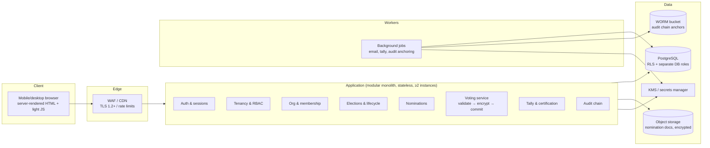
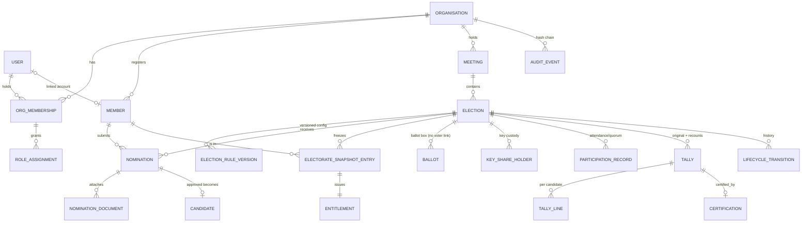
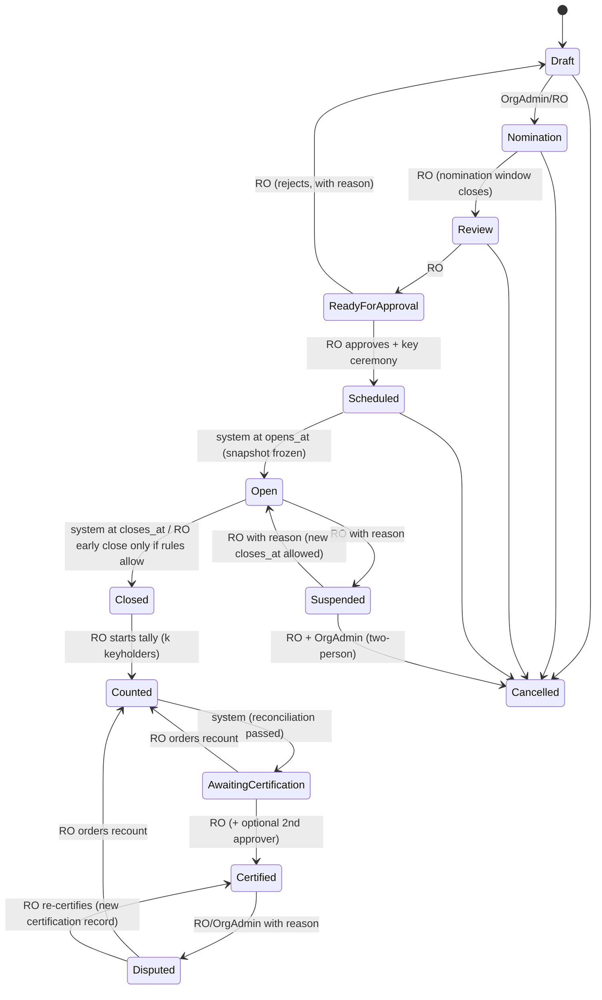

# Multi-Organisation Voting & Governance Platform — Implementation Blueprint (Draft v0.1)

> **Status:** **Approved (Phase 1 gate)** with recommended defaults — see [DECISIONS.md](DECISIONS.md). Phase 2–5 drafts: [02-architecture](02-architecture.md), [03-database-design](03-database-design.md), [04-ux-workflows](04-ux-workflows.md), [05-security-review](05-security-review.md). No code until the Phase 5 gate.
> **Scope of this draft:** sections 14.1–14.7 of the master build prompt.
> **Labels used throughout:**
> - **[CONFIRMED]** — stated as a requirement in the master build prompt.
> - **[ASSUMPTION]** — something I have inferred. It must be confirmed or corrected.
> - **[RECOMMENDATION]** — my proposed design choice. It needs approval.
> - **[LEGAL-REVIEW]** — a question to check against current primary law and the pilot club's governing documents. Nothing in this document is legal advice, and nothing here should be read as a claim of compliance.

---

## 0. Executive summary

- **Shape of the system:** a **modular monolith**. That means one deployable backend with clearly separated internal modules, one PostgreSQL database, and a server-rendered, mobile-first web UI. There are no microservices.
- **Tenant isolation is enforced twice:** once in the application (every query is scoped to an organisation) and once in **PostgreSQL Row-Level Security**. Both layers are tested by an automated cross-tenant test matrix.
- **Ballot secrecy uses a "separated entitlement + encrypted ballot box" design:**
  - Identity and the right to vote live in an `entitlements` table.
  - Choices live in a `ballots` table that has **no voter reference and no timestamp**.
  - Each ballot is encrypted to a **per-election public key**. The matching private key is **split between several keyholders** (threshold shares) and is only reassembled after voting closes, to count.
  - Linking a voter to their choices would require collusion, not just routine admin access.
- **One person, one vote is enforced at three levels:**
  - a database uniqueness constraint;
  - a row-locked single transaction that consumes the entitlement and inserts the ballot atomically;
  - a client idempotency key, so a retry is answered truthfully and never creates a second ballot.
- **Honest limitation:** a **compromised application server while voting is open** could observe choices, because the server must read and validate a ballot (for example, reject over-selection) before accepting it. This is documented in §6, with mitigations. Removing it requires end-to-end-verifiable cryptography, which belongs after the MVP.
- **Blocking inputs needed from you:** the pilot club's governing documents, the hosting region, the key-custody model, how members are verified, and whether in-person or paper ballots must be combined with online ones (§2.1).

---

## 1. Requirements-gap analysis

### 1.1 What is well specified [CONFIRMED]
- The eight MVP modules, six roles, the lifecycle states, the default election rules, the 17 acceptance tests, the exclusions and the phased workflow.
- Non-negotiables:
  - ballot secrecy against routine administrators;
  - one accepted ballot per member, enforced at the database level;
  - no false success messages;
  - tamper-evident audit records;
  - results held back until certification;
  - Kenya Data Protection Act 2019 considerations;
  - no claims of anonymity or certification beyond what has been demonstrated.

### 1.2 Gaps and ambiguities

| # | Gap | Why it matters | Proposed default |
|---|-----|----------------|------------------|
| G1 | The pilot club's constitution and election rules haven't been provided. | They decide the counting method, partial ballots, ties, quorum, eligibility cutoff, nomination rules, and whether remote electronic voting is allowed at all. | Build everything as configuration. Block the pilot until the documents are reviewed. |
| G2 | **Hybrid voting** isn't defined: can some members vote on paper or in person at the meeting? | Paper ballots would have to be merged with online ones without voting twice. This changes the entitlement model, the count and the quorum. | Online only for the MVP. If paper is needed, the Returning Officer marks a member's entitlement as "voted on paper", and paper totals are entered as a separately audited tally. |
| G3 | How **members are verified** isn't defined (email, phone, national ID, in person). | Verification is the root of trust for one person, one vote. A weak invitation flow makes it easy to impersonate a member. | The administrator imports the register (including email and phone). The invitation link goes to the email on record, and the member sets a password plus a second factor. Mismatches are resolved manually by the Returning Officer. |
| G4 | **Who can see who voted** (the "marked register") isn't defined. | It affects privacy and the design of the audit views. Many organisations treat turnout per member as non-secret. Some don't. | The Returning Officer and Auditor can see "voted / not voted". Org admins see only aggregate turnout. |
| G5 | **Key custody** for decrypting ballots isn't defined. | It is the main safeguard of secrecy and also a risk to availability: lose the keys and you lose the election. | Threshold sharing: 2 of 3 shareholders (the Returning Officer, the Auditor and an organisation officer), plus one sealed offline backup share. |
| G6 | **Nominations:** who may nominate (self, proposer or seconder?), required documents, and when the window closes. | It affects the nomination schema and workflow. | Self-nomination, plus an optional proposer and seconder who must be eligible members and must confirm in the app. One optional PDF upload. |
| G7 | **Whether members can see turnout while voting is open.** | A live turnout figure can influence voters. | Hidden from members. Aggregate turnout visible to the Returning Officer only. |
| G8 | **Where results are published** (members only, or public). | It affects access control. | Members of the organisation only. |
| G9 | **Notifications** (email only, or SMS too?). The prompt excludes SMS *campaigns*. | One-time passcodes by SMS and transactional SMS cost money, and SIM-swap fraud is a known problem in Kenya. | Email for transactional messages. An authenticator app (TOTP) as the second factor. SMS one-time passcodes are optional, can be turned on per organisation, and are not the default. |
| G10 | **Scale and service level** for the pilot (number of members, expected peak). | It affects sizing and load-testing targets. | Design for 10,000 members per organisation and 500 ballots per minute at peak. Pilot sizing to be confirmed. |
| G11 | **Retention periods** for ballots, audit records and personal data. | It is required by data-protection rules and by the possibility of election disputes. | Keep the encrypted ballots and audit records for the challenge period plus 12 months (configurable), then destroy the key shares (crypto-shredding). Personal data is kept while the member is active plus a configurable period. **[LEGAL-REVIEW]** |
| G12 | **Accessibility and language.** | Members may have mixed devices and abilities. | WCAG 2.2 AA target, English first, with the UI text ready for translation (Kiswahili later). |
| G13 | **Recounts:** who can order one, and on what grounds. | It affects lifecycle permissions. | The Returning Officer orders a recount, with a reason. Recounts are only allowed before certification, or in the Disputed state. |
| G14 | **Can an election be suspended and then resumed after its closing time?** | It affects the integrity of the voting window. | Resuming requires a new closing time set by the Returning Officer with a reason. The original window is kept in the history. |

---

## 2. Unresolved decisions and assumptions

### 2.1 Decisions that change the architecture, security or correctness (need your answer)

1. **D1 — Pilot governing documents.** Please supply the club's constitution or articles, its election regulations, and any rule allowing remote or electronic voting. **[LEGAL-REVIEW]**
2. **D2 — Hybrid voting (G2).** Online only, or online plus paper/in-person for the pilot?
3. **D3 — Key custody (G5).** Threshold shares held by people (recommended), or a single cloud key-management service (simpler, but whoever controls the cloud account can decrypt the ballots)?
4. **D4 — Hosting region and data residency.** The candidates are: a Kenyan provider or data centre; AWS Cape Town (af-south-1); Azure South Africa North; or an EU region. Cross-border transfer rules and any localisation requirements under the Data Protection Act and its Regulations need review. **[LEGAL-REVIEW]**
5. **D5 — Member verification and second factor (G3, G9).** Can we rely on email plus an authenticator app (TOTP)? Or do many pilot members need an SMS one-time passcode, which means a paid SMS provider?
6. **D6 — Marked-register visibility (G4).**
7. **D7 — Technology stack (§3.2).** The recommendation is Python/Django. Tell me if your team prefers TypeScript.
8. **D8 — Repository.** This repository (`Sueline-Tours-and-Travel`) holds unrelated video assets built with Remotion, a React video tool. I recommend a **new dedicated repository** for the platform, with this blueprint moved into it.

### 2.2 Working assumptions (proceed unless corrected) [ASSUMPTION]
- A1. A member belongs to an organisation through a membership record. One user account can be a member of several organisations.
- A2. The pilot is a single multi-seat plurality election: each voter selects up to N candidates and gets one vote per selected candidate.
- A3. Ballots cannot be changed after they are accepted.
- A4. Who voted is not secret from the Returning Officer and the Auditor. *How* they voted is secret.
- A5. There is no proxy voting, weighted voting or ranked voting in the MVP. The schema leaves room for them.
- A6. The 48-hour membership cutoff is **not** assumed. Eligibility cutoff is a configurable date and time, applied when the electorate snapshot is taken.
- A7. Tie-break procedure: the Returning Officer records the outcome of a procedure that was **pre-declared in the election configuration** (for example, drawing lots or a run-off). The system never breaks a tie automatically.
- A8. Quorum is evaluated against configured rules. The system reports "quorum met / not met" but does not decide whether the meeting is legally valid.
- A9. The pilot uses fictional data until Phase 8.

### 2.3 Sensible defaults for minor decisions [RECOMMENDATION]
- UUIDv4 primary keys. Times stored in UTC and shown in Africa/Nairobi time. Candidate order on the ballot is configurable (alphabetical by default, random rotation as an option).
- Password policy follows NIST SP 800-63B: at least 12 characters, checked against known-breached passwords, no forced rotation. Argon2id hashing.
- Sessions use server-side records with `HttpOnly; Secure; SameSite=Lax` cookies. Idle timeout of 15 minutes for privileged roles and 30 minutes for members.
- Privileged actions require recent re-authentication (step-up within 5 minutes): approving a configuration, opening, suspending, closing, the tally, certification and publication.

---

## 3. Proposed architecture

### 3.1 Logical architecture



Notes:
- **Voting service** and **Tally** are internal modules that use *different database roles*: `app_voting` may only insert ballots; `app_tally` may only read them. This narrows what a bug or compromise in any one module can do.
- Background jobs run as a separate process type from the same codebase.
- Logging (structured JSON) goes to a central log store. **Request bodies are never logged.** Ballot endpoints use an allow-list of fields that may be logged.

### 3.2 Technology options

| Criterion | **A. Django 5 + PostgreSQL + HTMX** (recommended) | B. NestJS/Next.js (TypeScript) + PostgreSQL | C. Rails 8 + PostgreSQL |
|---|---|---|---|
| Security maturity | Excellent. Built-in protection against CSRF, cross-site scripting and clickjacking. Argon2 supported. Long-term-support releases. | Good, but more is assembled from separate packages (auth, CSRF, validation). | Excellent, comparable to Django. |
| Built-in admin and back-office tools | Django Admin (restricted to the Platform Owner, with ballot tables excluded). | Must be built. | ActiveAdmin and similar. |
| Mobile-friendly UI | Server-rendered pages work on low-end phones and slow networks, and still work with JavaScript off. | A single-page app adds bundle size and attack surface. | Hotwire, similar to HTMX. |
| Cryptography | PyNaCl / libsodium, `cryptography`. | libsodium.js, node:crypto. | rbnacl. |
| Hiring and maintenance in Kenya | Python is widely known. | TypeScript is widely known. | A smaller pool. |
| Hosting cost (MVP) | About US$60–250/month for managed Postgres, two small app instances, object storage and email. | Similar. | Similar. |

**[RECOMMENDATION] Option A.** It needs the fewest separately assembled security components. Server-rendered pages reduce the client-side attack surface. Django's migrations, permissions and test tools suit a correctness-first product. If your team is TypeScript-first, Option B is a reasonable choice and the rest of this blueprint still applies.

**Supporting services:**
- managed PostgreSQL 16+ with point-in-time recovery;
- S3-compatible object storage with object lock (WORM) for audit anchors;
- a cloud KMS or secrets manager for application secrets;
- a transactional email provider;
- error tracking with personal-data scrubbing;
- GitHub Actions for continuous integration.

### 3.3 Tenant isolation strategy

1. **One database and shared tables, keyed by `organisation_id`.** Every table that holds an organisation's data has `organisation_id NOT NULL`.
2. **Composite foreign keys** of the form `(organisation_id, election_id) → elections(organisation_id, id)`. These make it *structurally impossible* for one organisation's row to point at another organisation's row.
3. **PostgreSQL Row-Level Security** on every such table:
   - The policy is `USING (organisation_id = current_setting('app.org_id')::uuid)`.
   - The application sets `app.org_id` at the start of each transaction, after authenticating the request.
   - The application's database roles are **not** table owners and do **not** have `BYPASSRLS`.
4. **The application layer** resolves the organisation from the URL (`/o/{org_slug}/…`) and the user's membership, never from a form field. Data-access code requires an organisation context or refuses to run.
5. **Platform-level operations** use a separate `app_platform` role and separate code paths. They have no access to ballot tables.
6. **Tests:**
   - An automated matrix logs in as each role in Org A and requests every endpoint and object in Org B. Every request must return 404 or 403.
   - Database-level tests try to read across organisations directly in SQL under the application role, both with no `app.org_id` set and with the wrong one.
   - These tests run in continuous integration and block any merge that fails them (acceptance test 1).

---

## 4. Ballot secrecy and duplicate prevention

### 4.1 Options considered

| Option | Secrecy | Duplicate prevention | Complexity | MVP fit |
|---|---|---|---|---|
| 1. Ballot row holds the member's ID, hidden in the UI | **None** against anyone with database access | Easy | Low | ❌ Ruled out by the prompt |
| 2. **Separated entitlement + encrypted ballot box, opened by a threshold key** | Good against routine admins, database readers, backups, and leaks of logs or analytics. Weak against a compromised app server *while voting is open*, and against collusion. | Strong: the same database transaction | Medium | ✅ **Recommended** |
| 3. Blind-signature tokens (Chaum) | Unlinkable even to the server, *if* a separate anonymous channel exists | Unique token serials | High. Tokens must be stored on the device, and a lost device means a lost vote. The server can't validate a ballot together with its voter's eligibility in one step. | ⚠ Later phase |
| 4. End-to-end-verifiable voting (homomorphic tally or mixnet, Helios/ElectionGuard style) | Strongest | Strong | Very high, and needs specialist review | ⚠ Roadmap item |

### 4.2 Recommended design (Option 2) [RECOMMENDATION]

**Setup (when the election moves from Ready for Approval to Scheduled):**
1. A **key ceremony** generates an X25519 election key pair with libsodium.
   - The **public key** is stored on the election record, along with its fingerprint, which goes into the audit chain.
   - The **private key** is split with Shamir secret sharing into *n* shares, with a threshold *k* (default 2 of 3, plus one sealed backup share). Each share is encrypted to its keyholder's passphrase and shown or downloaded once.
   - The whole private key is never stored, and it is wiped from memory after the ceremony.
2. When the election opens, the **electorate snapshot** is frozen. One **entitlement** row is created per eligible member, with `status = 'issued'`.

**Casting a ballot (a single endpoint, a single database transaction):**
```
POST /o/{org}/elections/{id}/ballot
  body: selections[], idempotency_key (random 128-bit value, generated when the ballot page loads),
        receipt_commitment = SHA-256(receipt_secret)   -- receipt_secret is generated and kept in the browser
BEGIN (READ COMMITTED; uses explicit row locks)
  SELECT … FROM elections   WHERE id=$e FOR SHARE;           -- status must be OPEN; database now() must be inside the voting window
  SELECT … FROM entitlements WHERE election_id=$e AND member_id=$m FOR UPDATE;
     - no row                                    → 403 "not eligible"
     - status='consumed' and idempotency matches → 200 "already accepted" (the truthful replay)
     - status='consumed' otherwise               → 409 "a ballot has already been accepted for you"
  validate selections: every candidate approved and in this election, no duplicates, count ≤ seats,
                       count ≥ minimum (0 if partial ballots are allowed)
  ciphertext = crypto_box_seal(canonical_json(selections, random_padding), election_public_key)
  INSERT INTO ballots(id=random_uuid, election_id, ciphertext, receipt_commitment)      -- no member ID, no timestamp
  UPDATE entitlements SET status='consumed', idempotency_hash=SHA-256(idempotency_key),
                          consumed_on = current_date   -- coarse precision on purpose; see 4.4
  INSERT audit_event('ballot.accepted', election_id, actor=member)   -- records *that* the member voted, never how
COMMIT
→ only after a successful COMMIT: 200 { accepted: true }; the browser shows a receipt built from receipt_secret
```

**Why each of the duplicate-prevention guarantees holds:**
- **Concurrent requests (acceptance test 4).** `FOR UPDATE` on the entitlement row forces concurrent requests to run one after another. The second request sees `consumed`. As a backstop, `UNIQUE(election_id, member_id)` on entitlements and a `CHECK` that a consumed entitlement has an idempotency hash make a second ballot impossible even if the application code has a bug.
- **Atomicity.** The ballot insert and the entitlement consumption commit together or not at all. So you can never get a consumed entitlement without a ballot, or a ballot without a consumed entitlement.
- **No false success (acceptance test 15).** The browser shows success only after the server confirms the commit. If the connection drops, the browser retries with the **same** idempotency key and gets a definite answer ("accepted" or "not accepted, try again"). A different device or a new page load gets "already accepted", never a second ballot.
- **Voting window (acceptance test 5).** The window is checked against database time inside the transaction. Closing the election takes `FOR UPDATE` on the election row, so it waits for in-flight ballots to finish and then blocks any new ones. There is no race at the closing boundary.
- **Ineligible voters (acceptance test 3).** Without an entitlement row nothing can be cast, and entitlements only come from the frozen snapshot.

**The receipt (acceptance test 7):**
- The receipt shows a short code derived from `receipt_secret`, which only the browser holds. It never contains the selections.
- After the election closes, the system publishes the list of accepted `receipt_commitment` values. Each voter can check that their ballot was counted.
- Because the decrypted contents are never published alongside the commitments, the receipt **cannot be used to prove to someone else how you voted**. That protects against coercion and vote-buying.

**Counting (Closed → Counted):**
1. The Returning Officer starts the tally. At least *k* keyholders enter their shares. The private key is rebuilt **in the memory of the tally worker only**.
2. The tally worker:
   - reads all ciphertexts for the election;
   - computes a Merkle root over them (the "ballot-set digest", recorded in the audit chain);
   - **shuffles them in memory**, decrypts, validates and aggregates;
   - wipes the key.
3. What gets stored:
   - per-candidate totals;
   - counts of valid and invalid ballots;
   - a reconciliation summary;
   - the ballot-set digest.

   The decrypted contents of individual ballots are **not stored** by default.
4. A **recount** repeats the process against the same encrypted ballots. It must reproduce the same digest. Recount results are stored as a new tally version, and the original is kept (acceptance test 13).
5. Reconciliation invariants. Any failure flags a **discrepancy** and blocks certification:
   - consumed entitlements = ballots;
   - ballots = valid + invalid;
   - sum of candidate totals = total valid selections;
   - for each ballot, selections ≤ seats.

**Optional, off by default:** publishing anonymised cast-vote records (the decrypted ballots, shuffled, with no IDs) so that someone outside the system can recount independently. This is a configurable trade-off against "pattern voting" coercion.

### 4.3 Who can see what

| Data | Member | Org Admin | Returning Officer | Auditor | Platform Owner | Database administrator |
|---|---|---|---|---|---|---|
| Own ballot choices | Not shown after casting | ✗ | ✗ | ✗ | ✗ | Ciphertext only |
| Who voted | Self only | Aggregate count only | ✓ (D6) | ✓ (D6) | ✗ | ✓ (raw tables) |
| Any individual ballot's contents | ✗ | ✗ | ✗ | ✗ | ✗ | ✗ without *k* key shares |
| Totals before certification | ✗ | ✗ | ✓ | ✓ | ✗ | ✓ (raw tables) |

### 4.4 Ways a voter could still be linked to their ballot, and mitigations
- **Timing.** The ballot has no timestamp. The entitlement records only a date. The audit event's timestamp is accurate to the minute and is visible only to the Returning Officer and Auditor. Ballot IDs are random, never sequential.
- **Physical row order and the database write-ahead log.** A database superuser with log or backup access might infer the order in which ballots were inserted, and match that against the order of the audit events. They would *still* need *k* key shares to read any ballot. This is documented as a **collusion risk**: database operator plus keyholders.
- **Application logs.** Ballot endpoints never log request bodies. A test asserts that no log line, error report, analytics event or notification contains a candidate ID that came from a ballot (acceptance test 8).
- **Ciphertext length.** The ballot is padded to a fixed size before encryption, so its length doesn't reveal how many candidates were selected.
- **Backups.** They hold only ciphertext. Destroying the key shares at the end of the retention period permanently disables decryption (crypto-shredding).

---

## 5. Draft entity-relationship model



Note that `BALLOT` has **no relationship** to `MEMBER` or `ENTITLEMENT`. That missing link is deliberate.

### 5.1 Entity catalogue

Abbreviations used in this table: **PII** = personally identifiable information; **ES** = election-sensitive; **RO** = Returning Officer; **PO** = Platform Owner.

| Entity | Purpose | Key fields and relationships | Validation and constraints | Access | Retention | PII / ES |
|---|---|---|---|---|---|---|
| `organisation` | A tenant | id, slug (unique), legal_name, country, timezone, governance_settings (jsonb), status | slug pattern rule; status ∈ {active, suspended} | PO; Org Admin (read/update own) | Life of contract + configurable period | Low |
| `user` | A login identity | id, email (unique, case-insensitive), password_hash (Argon2id), mfa_secret (encrypted), phone (optional), status | verified email required before first use | The user themselves; PO (metadata only) | Until the account is deleted, plus a legal hold if one applies | **PII** |
| `org_membership` | Links a user to an organisation | (organisation_id, user_id) unique | — | Org Admin | As for `user` | PII |
| `role_assignment` | Gives a role within an organisation (or for one election) | org_membership_id, role ∈ {org_admin, returning_officer, auditor, candidate, member}, election_id (optional), granted_by, valid_from/to | separation of duties: the person who certifies an election can't also be its configuring admin (configurable) | Org Admin grants; changes are audited | Kept permanently in the audit history | Low |
| `member` | The organisation's membership register entry | id, organisation_id, member_number (unique per organisation), full_name, category, subscription_status, joined_on, status, user_id (optional) | unique (organisation_id, member_number) | Org Admin (read/write); RO (read) | Configurable after leaving **[LEGAL-REVIEW]** | **PII** |
| `meeting` | An AGM or special meeting | id, organisation_id, type, scheduled_at, location / remote flag | — | Org Admin, RO | Kept with the election records | Low |
| `election` | An election and its lifecycle | id, organisation_id, meeting_id, title, state, seats, opens_at, closes_at, public_key, public_key_fpr, current_rule_version_id | seats ≥ 1; closes_at > opens_at; state changes only through the lifecycle service and a database trigger | Org Admin (while in Draft); RO | Kept with the election records | ES |
| `election_rule_version` | Unchangeable snapshots of the rules | id, election_id, version, rules (jsonb: min/max selections, partial ballots allowed, counting method, tie procedure text, quorum rule, eligibility cutoff), approved_by, approved_at, sha256 | a new row for every change; once the election is Scheduled, rules can't be edited (enforced by trigger) | Org Admin drafts; RO approves | Kept with the election records | ES |
| `nomination` | A candidacy application | id, election_id, member_id, statement, proposer_member_id, seconder_member_id, status ∈ {submitted, withdrawn, approved, rejected}, decided_by, decided_at, reason | the nominee must be eligible; a reason is required to reject; unique (election_id, member_id) | Candidate (own); RO decides; Org Admin (read) | Kept with the election records | PII |
| `nomination_document` | A supporting file | id, nomination_id, object_key, sha256, mime, size | PDF/JPEG/PNG only, at most 5 MB, virus-scanned | Candidate (own); RO | Kept with the election records | PII |
| `candidate` | An approved ballot entry | id, election_id, nomination_id, display_name, ballot_order | can't be changed once Open (trigger) | Everyone in the electorate (read) | Kept with the election records | PII (name) |
| `electorate_snapshot_entry` | The frozen electorate | (election_id, member_id) unique, member_category, eligibility_basis, snapshot_hash | can't be changed once Open (trigger) | RO, Auditor | Kept with the election records | PII |
| `entitlement` | The right to vote once | id, election_id, member_id, status ∈ {issued, consumed, revoked, paper}, consumed_on (date), idempotency_hash | **UNIQUE (election_id, member_id)**; `CHECK (status <> 'consumed' OR idempotency_hash IS NOT NULL)`; only issued → consumed/revoked is allowed, and revoking needs an RO reason | RO, Auditor (who voted); the member (own status) | Kept with the election records | PII + ES |
| `ballot` | A sealed ballot | id (random UUID), organisation_id, election_id, ciphertext (bytea), receipt_commitment (unique) | **no member, entitlement or timestamp columns**; insert-only (UPDATE/DELETE revoked, plus a trigger) | Insert: `app_voting` role; read: `app_tally` role only | Encrypted ballots kept for the challenge period + configured period, then crypto-shredded | **ES (high)** |
| `key_share_holder` | A record of who holds a key share | election_id, user_id, share_index, public fingerprint | the shares themselves are **never** stored | RO, Auditor | Kept with the election records | Low |
| `participation_record` | Attendance and quorum evidence | election_id, member_id, kind ∈ {registered_attendance, online_ballot, paper}, recorded_by | unique (election_id, member_id, kind) | RO, Auditor | Kept with the election records | PII |
| `tally` | One run of the count | id, election_id, version, kind ∈ {original, recount}, ballot_set_digest, totals_valid/invalid, reconciliation (jsonb), tie_flags, status, run_by, run_at, reason (recounts) | unchangeable once stored; a recount must have the same digest | RO, Auditor; members after publication | Kept with the election records | ES |
| `tally_line` | Votes per candidate | tally_id, candidate_id, votes, rank, elected flag, tie_group | — | As for `tally` | As for `tally` | ES |
| `tie_resolution` | The outcome of a tie-break | tally_id, tie_group, procedure (copied from the rules), outcome, evidence, recorded_by | the procedure must match the approved rule version | RO | Kept with the election records | ES |
| `certification` | The certification decision | tally_id, certified_by, second_approver (optional), statement, signed_hash, published_at, published_by | at most one active certification per election; can't be changed (trigger); publishing needs a separate permission | RO certifies; Org Admin or RO publishes | Kept permanently | ES |
| `lifecycle_transition` | State history | election_id, from_state, to_state, actor, reason, at | must be a permitted transition for that actor's role | RO, Auditor | Kept permanently | Low |
| `audit_event` | A tamper-evident log | id, organisation_id, seq (per organisation), at, actor_id, action, object_ref, details (jsonb, **never ballot contents**), prev_hash, hash | insert-only; hash = SHA-256(prev_hash ‖ canonical(event)); the chain head is copied regularly to WORM storage | Auditor, RO, Org Admin (filtered views) | Kept permanently, with personal data redacted where the law requires | PII (actor) |

---

## 6. Threat model (main election-integrity risks)

The adversaries considered are:
- an outside attacker;
- a malicious member;
- a malicious candidate;
- a curious or malicious Org Admin;
- a malicious Returning Officer;
- the platform operator or a database administrator;
- a compromised cloud account;
- colluding insiders.

| # | Threat | Adversary | Impact | Mitigation | Residual risk |
|---|---|---|---|---|---|
| T1 | Taking over a member's account to vote as them | Outside attacker | Wrong vote; one person, one vote broken in effect | Second factor; breached-password check; rate limits and lockout with backoff; invitations sent only to contact details on file; alerts on new devices | Theft of an email account plus a second-factor device; SIM swap if SMS one-time passcodes are enabled |
| T2 | Voting twice (concurrency, retries, several devices) | Member | Inflated tally | Row lock + UNIQUE constraint + atomic transaction + idempotency key; reconciliation invariant | Very low |
| T3 | An ineligible person votes through crafted API calls | Member or outsider | Invalid electorate | Entitlement only from the frozen snapshot; checked on the server; organisation scoping + RLS | Low |
| T4 | An admin quietly edits the electorate or candidates after opening | Org Admin | Rigged election | Freeze triggers; database role lacks the grants; changes only through Suspend with an RO reason; hash of the snapshot recorded in the audit chain | Collusion between admin and RO, which stays visible in the audit trail |
| T5 | An admin or operator reads individual choices | Org Admin, database admin, platform operator | Secrecy broken | Encrypted ballots; key split between keyholders; no voter link; no timestamps; no logging | Collusion between the database admin and *k* keyholders |
| T6 | A compromised application server during voting reads or changes choices | Outside attacker or insider | Secrecy and integrity broken in real time | Hardened, minimal hosts; access through a short-lived bastion; dependency pinning and scanning; code integrity checks; monitoring; voters can check their receipt is in the published list | **Significant residual risk in the MVP.** Removing it needs end-to-end-verifiable voting (§4.1, option 4) |
| T7 | Ballots changed or deleted after acceptance | Insider | Wrong result | Insert-only grants and triggers; ballot-set Merkle digest recorded in the audit chain when voting closes; a recount must reproduce the digest | A superuser could change data *and* rewrite the chain, but the anchors in WORM storage expose this |
| T8 | Audit log rewritten | Insider | Lost accountability | Hash chain; regular anchoring to object-locked storage; the Auditor can verify the chain independently | Anchoring interval (default 15 minutes) |
| T9 | Results tampered with or released early | Org Admin or RO | Wrong or premature result | Tally only after Closed; totals visible only to RO and Auditor; certification can't be changed; separate permissions to certify and to publish; step-up authentication | Malicious RO, mitigated by an optional second approver |
| T10 | Key shares lost, so the count is impossible | Accident | Election can't be counted | Threshold *k* < *n*; sealed backup share; a test decryption during the key ceremony | Losing more than *n* − *k* shares |
| T11 | Data leaked between organisations | Bug | Privacy breach | Composite foreign keys + RLS + test matrix | Low |
| T12 | Denial of service during the voting window | Outside attacker | People can't vote; legitimacy challenged | CDN/WAF; autoscaling; load testing; the RO can suspend the election and extend the closing time (audited) | Medium. Rules on whether the window can be extended are **[LEGAL-REVIEW]** |
| T13 | Coercion or vote-buying using the receipt | Third party | Distorted outcome | The receipt doesn't reveal choices; decrypted ballots aren't published alongside receipts | Someone standing over the voter while they vote. This is inherent to remote voting. |
| T14 | Choices leak through logs, analytics, error trackers or email | Bug | Secrecy broken | Field allow-lists; no third-party analytics on voting pages; personal-data scrubbing; automated "canary candidate" leak test | Low |
| T15 | Malicious nomination upload (malware or cross-site scripting) | Candidate | Compromised staff device | File-type checks, virus scanning, separate download domain, `Content-Disposition: attachment` | Low |
| T16 | Phishing site copying the voting page | Outside attacker | Credentials stolen | Second factor (WebAuthn/passkeys preferred for officials); official domain announced in advance; voter education | Medium |

---

## 7. Election lifecycle (state machine)



- A **database trigger** rejects any state change that isn't in the permitted-transitions table. The application service also checks the actor's role and requires a reason.
- There are no transitions back to `Open` from `Closed` or later, and none back to `Draft` from `Scheduled` or later. An election can't be reopened or restarted. A new election has to be created, with a reference to the old one.
- Every transition writes both a `lifecycle_transition` row and an `audit_event`.

---

## 8. Privacy and legal points to verify [LEGAL-REVIEW]

These are areas the design is built to support, **not** compliance claims. Each one needs to be checked against the current Act, the Data Protection (General) Regulations 2021, the registration regulations and guidance from the Office of the Data Protection Commissioner (ODPC):

- the roles of controller and processor: the organisation as controller and the platform as processor, plus a data processing agreement template;
- whether the platform and/or customers must register with the ODPC, and the thresholds for that;
- whether a data protection impact assessment is needed (it is likely, given election data). It is scheduled in Phase 5;
- the deadlines and process for notifying a personal data breach;
- the conditions for cross-border transfers, and any requirements to process data within Kenya (decision D4);
- how data subject rights apply to the electorate snapshot and to ballots. Ballots hold no personal data, by design. The snapshot may need to be kept for the dispute period;
- whether the pilot organisation's legal form and rules (for example, a society, a company limited by guarantee or an association) allow remote electronic voting, and on what notice and quorum terms.

---

## 9. Phased implementation plan with acceptance gates

| Phase | Deliverables | Exit gate (who approves) |
|---|---|---|
| **1. Requirements validation** | This document plus answers to D1–D8; a consolidated product requirements document; the pilot club's rules mapped to configuration settings | Sponsor approves the requirements; the pilot rules have been reviewed **[LEGAL-REVIEW]** |
| **2. Architecture** | Final architecture and data-flow diagrams; stack decision; tenant-isolation design; threat model v1 | Architecture sign-off |
| **3. Database design** | Final schema, migrations plan, constraint and trigger catalogue, RLS policies, retention schedule | Schema review, including a walkthrough of how secrecy is preserved |
| **4. UX and workflows** | Clickable wireframes for administrator, Returning Officer, candidate and member flows, including error states (ineligible, closed, already voted, network loss, over-selection) | Usability walkthrough on low-end Android and iOS phones |
| **5. Security review** | Threat model v2, key-ceremony procedure, DPIA draft, authentication design, logging policy, backup and recovery plan | Security sign-off; DPIA reviewed |
| **6. Prototype, in increments** (each one is a pull request with tests) | 6.1 Skeleton, continuous integration, auth, tenancy + RLS + cross-tenant test matrix → 6.2 Organisation, membership and invitations → 6.3 Elections, rule versions, lifecycle → 6.4 Nominations → 6.5 Snapshot, entitlements, key ceremony → 6.6 Ballot casting (concurrency and idempotency tests) → 6.7 Tally, reconciliation, ties, recount, certification, publication → 6.8 Quorum, audit chain and anchoring, auditor views | Each increment must pass its acceptance tests in continuous integration |
| **7. Verification** | All 17 acceptance tests; a concurrency stress test (e.g. 1,000 parallel duplicate submissions → exactly one ballot); counting checked against an independent reference implementation over randomised fictional elections; fault-injection tests (killing the connection before and after commit); restore from backup; the leak-canary test; OWASP ASVS Level 2 checklist; testing on mobile browsers (Chrome Android, Safari iOS, Samsung Internet) | All tests pass; the test report is reviewed |
| **8. Pilot readiness** | Independent penetration test and cryptography review; operations runbooks (key ceremony, incident response, suspension, dispute handling); dry-run election with fictional data; register of risks still open; signed data processing agreement | Go/no-go decision by the sponsor, the pilot club's Returning Officer and the security reviewer |

**Mapping of acceptance tests to increments:**

| Increment | Acceptance tests |
|---|---|
| 6.1 | 1 |
| 6.2 | 2, 3 |
| 6.3 | 5, 12 |
| 6.6 | 4, 6, 7, 15 |
| 6.7 | 9, 10, 11, 13, 14 |
| 6.8 | 8 |
| Phase 7 | 16, 17 |

---

## 10. What I need from you to proceed

1. Answers to **D1–D8** (§2.1). The most urgent are **D1** (governing documents), **D2** (whether hybrid voting is needed), **D3** (key custody) and **D4** (hosting region).
2. Approval of, or changes to, the working assumptions A1–A9 and the defaults in §2.3.
3. Approval of the recommended architecture (§3) and ballot design (§4), or a decision to explore option 3 or 4 instead.

Once these are approved, Phase 2–3 deliverables will be produced as follow-up documents. Code starts only after the Phase 5 gate.
